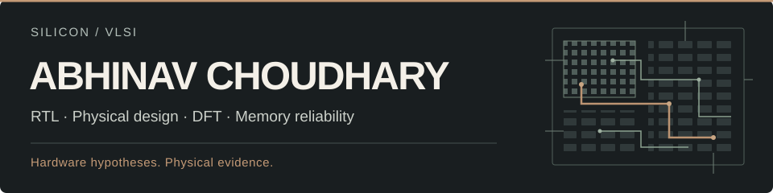
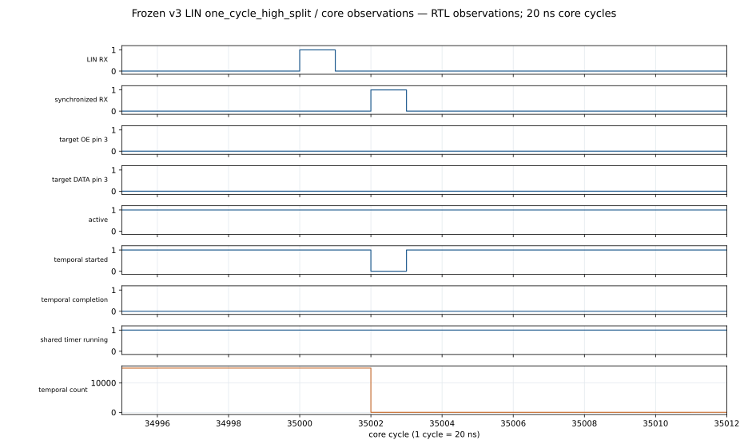

[Portfolio](https://its-abhinav.lovable.app/) · [LinkedIn](https://www.linkedin.com/in/itsofficialabhinav/) · [ORCID](https://orcid.org/0009-0001-4892-5438)

**Explore:** [GREENS](#greens--sram-reliability--ecc) · [PACT](#pact--physical--atpg-aware-scan-optimization) · [CHRONOS](#chronos--temporal-io-architecture) · [MOTIF](#motif--composable-serial-io)

I build and evaluate digital hardware, from RTL and architecture to physical implementation, timing and test. My work centers on SRAM reliability, ECC, DFT and open-source EDA. I follow a hardware idea far enough to test its assumptions—and keep the evidence when it fails.

<table>
<tr><td><b>Focus</b></td><td>Memory protection, scan architectures and programmable I/O</td></tr>
<tr><td><b>Research</b></td><td>GREENS at IIIT-Delhi / VICAS Lab, advised by Dr. Anuj Grover</td></tr>
<tr><td><b>Industry</b></td><td>Cadence — Quantus validation intern; STMicroelectronics — research intern</td></tr>
<tr><td><b>Education</b></td><td>M.Tech, ECE · VLSI &amp; Embedded Systems · IIIT-Delhi, 2024–2026</td></tr>
</table>

## Selected silicon work

### [GREENS](https://github.com/wellitsabhinav/Error-Code-Correction) · SRAM reliability & ECC

Connects ECC RTL and correctness checks to routed implementation and operation-energy evidence. Across four admitted SKY130 seed pairs, Hsiao used less ECC-logic energy in **4 of 20** seed/operation comparisons: the preference depends on the workload. No whole-SRAM energy winner is established.

[Reproduce the study](https://github.com/wellitsabhinav/Error-Code-Correction/blob/main/experiments/iscas/README.md) · [Claims & evidence](https://github.com/wellitsabhinav/Error-Code-Correction/blob/main/experiments/iscas/claims.md)

### [PACT](https://github.com/wellitsabhinav/PACT--Physical-and-ATPG-aware-Co-optimization-of-Test-architectures) · Physical + ATPG-aware scan optimization

Searches legal scan orders using placement and ATPG activity, then checks them through serial replay, routing and physical qualification. Proxy gains transferred unevenly. The final study found **no material static IR-drop benefit**; the hypothesis is frozen, with the methodology, scaling experiments and negative results preserved.

[Routed evidence](https://github.com/wellitsabhinav/PACT--Physical-and-ATPG-aware-Co-optimization-of-Test-architectures/blob/main/docs/reproduction/canonical_results.md) · [Final decision](https://github.com/wellitsabhinav/PACT--Physical-and-ATPG-aware-Co-optimization-of-Test-architectures/blob/main/reports/gate10a/decision.json)

### [CHRONOS](https://github.com/wellitsabhinav/CHRONOS-Guarded-Temporal-IO) · Temporal I/O architecture

A timestamped GPIO event engine explored for the Jane Street protocol-emulator ASIC competition. M0 reached GDS, STA/DRC/LVS and routed gate checks, backed by differential simulation and bounded formal checks. Later guards and timestamps showed no baseline advantage; the final eventless SPI candidate failed autonomous CS framing. **Research closed.**

[M0 physical checkpoint](https://github.com/wellitsabhinav/CHRONOS-Guarded-Temporal-IO/blob/main/docs/results/m0_physical.md) · [Final falsification](https://github.com/wellitsabhinav/CHRONOS-Guarded-Temporal-IO/blob/main/docs/eventless_cs_framed_spi_gate.md)

### [MOTIF](https://github.com/wellitsabhinav/MOTIF-Protocol-Motif-Machine) · Composable serial I/O

Tests whether fixed-table compound operations generalize across protocols. Frozen v3 passed all **34** independently selected LIN break/sync-prefix cases without semantic changes; earlier reuse failures remain documented. One routed v3 attempt failed setup; the final attempt timed out. Logical generalization is bounded to the tested prefix; **physical qualification remains unestablished**.

[Architecture & demonstrations](https://github.com/wellitsabhinav/MOTIF-Protocol-Motif-Machine/blob/main/docs/demo/README.md) · [Final campaign report](https://github.com/wellitsabhinav/MOTIF-Protocol-Motif-Machine/blob/main/docs/research/v3_temporal_qualification/final_report.md)

Inspect a real RTL trace: MOTIF rejects an interrupted LIN break

Bounded digital simulation, not full LIN compliance. Unmodified <a href="https://github.com/wellitsabhinav/MOTIF-Protocol-Motif-Machine/blob/9e4c500/docs/demo/figures/unseen/one_cycle_high_split/waveform_34995_35012.svg">MOTIF trace</a> from revision <code>9e4c500</code>, under <a href="assets/LICENSE-MOTIF.txt">Apache-2.0</a>; <a href="assets/NOTICE-MOTIF.txt">upstream notice</a> retained.

## Engineering approach

Model → implement → verify → evaluate physically → document what survives.

## Hardware stack

**RTL / modeling:** SystemVerilog · Verilog · C++ · Python 
**Verification / test:** cocotb · Icarus Verilog · Verilator · bounded formal checks · FAN_ATPG 
**Implementation:** Yosys · OpenROAD / ORFS · OpenSTA · STA · DFT · SRAM / ECC
