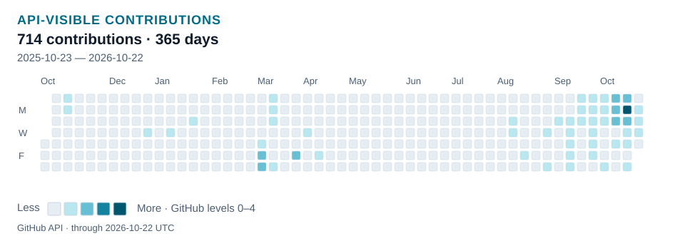
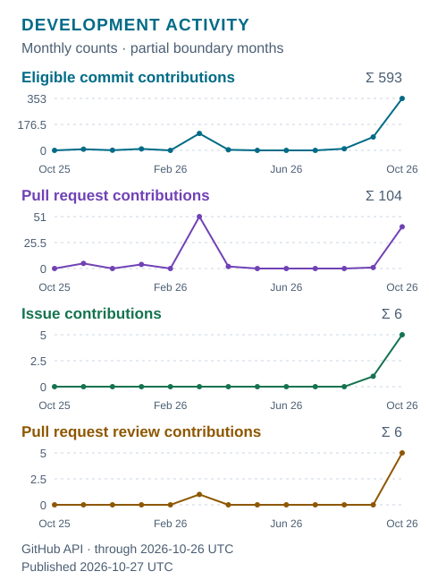
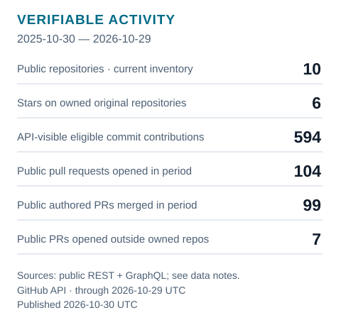

<picture>
  <source media="(prefers-color-scheme: dark)" srcset="assets/branding/header-dark.svg" />
  
</picture>

# Abhinav Choudhary

**Silicon Design Engineer | VLSI Researcher | Open-Source EDA Contributor**

I build and evaluate digital hardware across RTL, verification, physical implementation, timing, DFT and memory reliability. My research connects architectural choices to reproducible implementation evidence, including the experiments that reject an idea.

*From architecture and RTL to verification, timing closure, and physical evidence.*

[GitHub](https://github.com/wellitsabhinav) · [LinkedIn](https://www.linkedin.com/in/itsofficialabhinav/) · [Portfolio](https://its-abhinav.lovable.app/) · [ORCID 0009-0001-4892-5438](https://orcid.org/0009-0001-4892-5438)

[Projects](#selected-engineering-projects) · [Upstream contributions](#open-source-contributions) · [Experience](#industry-and-education) · [Activity](#github-activity)

## Engineering focus

- **Memory systems:** SRAM protection, ECC hardware and conditional reliability–energy tradeoffs.
- **RTL to implementation:** digital architecture, independent verification, STA and routed evaluation.
- **Design for test:** scan architectures, ATPG, fault simulation and EDA automation.
- **Computer architecture:** programmable temporal I/O and bounded protocol operations.

## Selected engineering projects

### [GREENS — SRAM reliability and ECC](https://github.com/wellitsabhinav/Error-Code-Correction)

**Question:** which protection hardware is preferable under a defined service, timing constraint and operation mix? GREENS connects ECC RTL and correctness checks to matched routed implementations and operation-energy evidence. Across **four admitted SKY130 seed pairs**, Hsiao used less ECC-logic energy in **4 of 20** seed/operation comparisons. The preference is workload dependent; no whole-SRAM energy winner is established.

**Status:** evidence-qualified research artifact; manuscript publication status is unverified. **Tools:** Verilog/SystemVerilog, Python, Yosys, OpenROAD/OpenSTA, SKY130HD and SRAM22 macros.

[Code](https://github.com/wellitsabhinav/Error-Code-Correction) · [Reproduce the claims](https://github.com/wellitsabhinav/Error-Code-Correction/blob/main/experiments/iscas/reproduction.md) · [Claim-to-evidence index](https://github.com/wellitsabhinav/Error-Code-Correction/blob/main/experiments/iscas/claims.md) · [Results and figure](https://github.com/wellitsabhinav/Error-Code-Correction/blob/main/docs/results.md)

### [PACT — physical and ATPG-aware scan optimization](https://github.com/wellitsabhinav/PACT--Physical-and-ATPG-aware-Co-optimization-of-Test-architectures)

**Question:** can placed geometry and ATPG switching guide scan orders whose gains survive routing? PACT searches legal orders and checks them through independent serial replay, routing and physical qualification. **Nine frozen architectures qualified** in the final static power-integrity study, but primary worst-drop improvements were only **3 µV and 8 µV**: **no material static IR-drop benefit** under the registered conditions. Routed transfer was mixed.

**Status:** original hypothesis frozen; methodology and negative results retained. **Tools:** Python/C++, Tcl, OpenROAD, OpenSTA and FAN_ATPG. No transient-droop or thermal benefit is established.

[Code](https://github.com/wellitsabhinav/PACT--Physical-and-ATPG-aware-Co-optimization-of-Test-architectures) · [Reproduction and canonical results](https://github.com/wellitsabhinav/PACT--Physical-and-ATPG-aware-Co-optimization-of-Test-architectures/blob/main/docs/reproduction/canonical_results.md) · [Final physical report](https://github.com/wellitsabhinav/PACT--Physical-and-ATPG-aware-Co-optimization-of-Test-architectures/blob/main/reports/gate10a/report.md) · [Freeze decision](https://github.com/wellitsabhinav/PACT--Physical-and-ATPG-aware-Co-optimization-of-Test-architectures/blob/main/reports/gate10a/decision.json)

### [CHRONOS — programmable temporal I/O](https://github.com/wellitsabhinav/CHRONOS-Guarded-Temporal-IO)

**Question:** can timestamped events decouple GPIO timing from producer latency? The M0 event engine reached GDS, STA/DRC/LVS and routed gate checks, with **48,000 randomized differential cycles** and a **24-edge bounded formal check**. Later guards and timestamps showed no baseline advantage; the final eventless SPI candidate failed autonomous CS framing.

**Status:** research closed; the verified M0 checkpoint is distinct from the unsuccessful later directions. **Tools:** SystemVerilog, Python, cocotb, Icarus, Verilator, Yosys and IHP CMOS5L. No fabricated-silicon result is claimed.

[RTL and run instructions](https://github.com/wellitsabhinav/CHRONOS-Guarded-Temporal-IO#run-and-verify) · [M0 verification](https://github.com/wellitsabhinav/CHRONOS-Guarded-Temporal-IO/blob/main/docs/results/m0_verification.md) · [M0 physical checkpoint](https://github.com/wellitsabhinav/CHRONOS-Guarded-Temporal-IO/blob/main/docs/results/m0_physical.md) · [Final falsification](https://github.com/wellitsabhinav/CHRONOS-Guarded-Temporal-IO/blob/main/docs/eventless_cs_framed_spi_gate.md)

### [MOTIF — protocol motif machine](https://github.com/wellitsabhinav/MOTIF-Protocol-Motif-Machine)

**Question:** how far can fixed-table compound operations generalize across serial protocols? Frozen v3 passed **all 34 independently selected LIN break/sync-prefix cases**, over **3,210,266 model/RTL cycles**, without semantic changes. This is bounded prefix recognition, not full LIN compliance. Earlier reuse failures remain documented. One routed v3 attempt failed setup; the final attempt timed out.

**Status:** logical and matched-cost gates passed; **physical qualification remains unestablished**. **Tools:** SystemVerilog, Python, cocotb, Icarus, Yosys and IHP CMOS5L.

[Code and verification](https://github.com/wellitsabhinav/MOTIF-Protocol-Motif-Machine) · [Runnable demonstrations](https://github.com/wellitsabhinav/MOTIF-Protocol-Motif-Machine/blob/main/docs/demo/README.md) · [Architecture](https://github.com/wellitsabhinav/MOTIF-Protocol-Motif-Machine/blob/main/docs/architecture.md) · [Final campaign report](https://github.com/wellitsabhinav/MOTIF-Protocol-Motif-Machine/blob/main/docs/research/v3_temporal_qualification/final_report.md)

[Inspect an actual RTL waveform: an interrupted LIN break produces no prefix token](assets/motif-lin-interruption.svg). Bounded digital simulation from [MOTIF revision 9e4c500](https://github.com/wellitsabhinav/MOTIF-Protocol-Motif-Machine/blob/9e4c500/docs/demo/figures/unseen/one_cycle_high_split/waveform_34995_35012.svg); unmodified [Apache-2.0 asset](assets/LICENSE-MOTIF.txt), [notice retained](assets/NOTICE-MOTIF.txt).

## Open-source contributions

Implementation fixes, native regressions and minimal reproducers make the work inspectable beyond my own projects. These are contributions to other maintainers' repositories; my OpenSTA/OpenROAD repositories are contribution forks.

| Evidence | Engineering change | Verified outcome |
|---|---|---|
| [OpenSTA #538](https://github.com/parallaxsw/OpenSTA/pull/538), [issue #537](https://github.com/parallaxsw/OpenSTA/issues/537) | Reject unsupported `wor`/`wand` declarations before alias merging corrupts input connectivity | **Merged 15 Oct 2026**; issue closed. Does not implement wired-logic support. |
| [OpenSTA fork #420](https://github.com/The-OpenROAD-Project/OpenSTA/pull/420) | Preserve renamed input aliases; reject shared signal inputs before opening the output file; seven native regressions | **Merged 20 Oct 2026** into The-OpenROAD-Project/OpenSTA |
| [OpenSTA #540](https://github.com/parallaxsw/OpenSTA/pull/540), [issue #536](https://github.com/parallaxsw/OpenSTA/issues/536) | Port the writer repair to canonical upstream, with registered Tcl regressions | **Merged 21 Oct 2026** |
| [OpenROAD #11624](https://github.com/The-OpenROAD-Project/OpenROAD/pull/11624) | Keep top ports on local module nets through child feedthroughs; add connectivity/DEF regressions | **Merged 21 Oct 2026** into canonical upstream |

**Open proposals, checked 24 Oct 2026:** [FAN_ATPG #4](https://github.com/NTU-LaDS-II/FAN_ATPG/pull/4) repairs empty reports, scan identities and unsafe negative indexing. [DFT #1](https://github.com/mwsoli/OpenROAD/pull/1) and [DFT #2](https://github.com/mwsoli/OpenROAD/pull/2) target a maintainer's OpenROAD fork: compilation, fixed scan endpoints and metadata consistency. These are not upstream merges. [FAN construction report #5](https://github.com/NTU-LaDS-II/FAN_ATPG/issues/5) and [fault identity report #6](https://github.com/NTU-LaDS-II/FAN_ATPG/issues/6) preserve additional reproductions. [Current automated status timeline](assets/activity/SUMMARY.md#upstream-evidence).

## Industry and education

- **Cadence Design Systems — Product Validation / Quantus internship.** Parasitic-extraction validation context.
- **STMicroelectronics — Physical and Layout Design research internship.** Physical/layout engineering context.
- **M.Tech, ECE — VLSI and Embedded Systems, IIIT-Delhi, 2024–2026.** GREENS originated at VICAS Lab under Dr. Anuj Grover.

Project evidence here is public research and open-source work; no proprietary implementation, customer data or company performance claims are included. [Professional background](https://its-abhinav.lovable.app/) · [LinkedIn](https://www.linkedin.com/in/itsofficialabhinav/).

## Technical stack

**RTL:** Verilog, SystemVerilog. **Programming and automation:** C++, Python, Tcl, Bash. 
**Verification:** cocotb, Verilator, Icarus Verilog, differential simulation, bounded formal checks. 
**Physical implementation:** Yosys, OpenROAD / ORFS, OpenSTA, STA; SKY130HD and IHP CMOS5L. 
**DFT:** scan architectures, FAN_ATPG, fault simulation. **Research:** SRAM reliability, ECC and PPA tradeoffs.

## GitHub activity

Real GitHub data, refreshed approximately daily. The calendar shows **contributions across eligible event types**; the trend separates eligible commits, PRs, issues and submitted PR reviews. The last completed UTC date appears in every graphic. Counts follow API visibility; anonymous restricted aggregates may appear in the calendar. [Definitions and limitations](docs/ACTIVITY_DATA.md) · [Selectable statistics, monthly values and timeline](assets/activity/SUMMARY.md) · [Daily source data](assets/activity/activity.json).

<picture>
  <source media="(prefers-color-scheme: dark) and (max-width: 600px)" srcset="assets/activity/calendar-mobile-dark.svg" />
  <source media="(max-width: 600px)" srcset="assets/activity/calendar-mobile-light.svg" />
  <source media="(prefers-color-scheme: dark)" srcset="assets/activity/calendar-dark.svg" />
  
</picture>

<picture>
  <source media="(prefers-color-scheme: dark)" srcset="assets/activity/trend-dark.svg" />
  
</picture>
<picture>
  <source media="(prefers-color-scheme: dark)" srcset="assets/activity/stats-dark.svg" />
  
</picture>

[Open-source milestone graphic](assets/activity/timeline-light.svg) · [Dark variant](assets/activity/timeline-dark.svg) · [Each milestone and its original evidence in text](assets/activity/SUMMARY.md#upstream-evidence).

Model → implement → verify → evaluate physically → document what survives.
